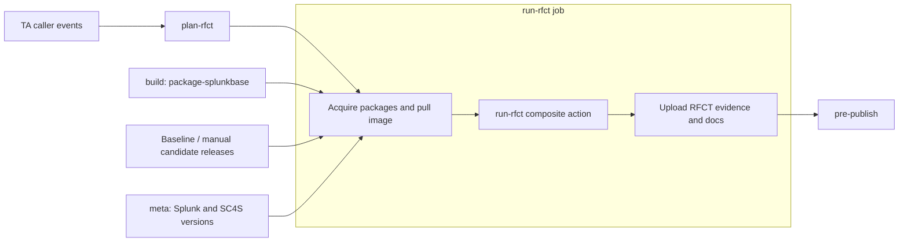

<!--
Copyright 2026 Splunk Inc.

Licensed under the Apache License, Version 2.0 (the "License");
you may not use this file except in compliance with the License.
You may obtain a copy of the License at

    http://www.apache.org/licenses/LICENSE-2.0

Unless required by applicable law or agreed to in writing, software
distributed under the License is distributed on an "AS IS" BASIS,
WITHOUT WARRANTIES OR CONDITIONS OF ANY KIND, either express or implied.
See the License for the specific language governing permissions and
limitations under the License.
-->

# RFCT action and CIM changes job for the reusable release workflow

Status: proposal for ADDON-90824. This document specifies the feature; the
action and workflow job are not implemented by this specification PR.

Issue: [ADDON-90824](https://splunk.atlassian.net/browse/ADDON-90824).
Workflow baseline: `develop` at
[`e884eeb2a88a13245dffc6aa67a5044064dc9a13`](https://github.com/splunk/addonfactory-workflow-addon-release/tree/e884eeb2a88a13245dffc6aa67a5044064dc9a13).

## Intended result

When an opted-in TA changes its CIM mappings, run the published RFCT image to
compare the candidate package with a released baseline. Generate the versioned
CIM changes documentation and upload it with comparison evidence. A controlled
manual dispatch must support an explicit baseline and candidate release.

The eventual implementation PR is a `feat` change targeting `develop`. Initial
rollout is opt-in. Generated documentation is a workflow artifact for review;
committing documentation, opening a TA documentation PR, deploying docs, and
adding release assets are later consumers of this artifact contract.

## Existing integration points

- `.github/workflows/reusable-build-test-release.yml` declares `workflow_call`.
  Event subscriptions and `workflow_dispatch` belong to the TA caller in
  `addonfactory-repository-template/adjust/.github/workflows/build-test-release.yml`.
- `build` produces the candidate `package-splunkbase` artifact and a `buildname`
  output. PR package versions can be synthetic (`0.<PR>.<run-id>`).
- `meta` resolves supported/latest Splunk and SC4S versions.
- `run-knowledge-tests` runs through WFE. Its completed run does not provide a
  supported pair of live Splunk endpoints for an RFCT process on the GitHub runner.
- `pre-publish` aggregates job results and accepts skipped dependencies. An RFCT
  integration therefore needs an explicit required-versus-skipped decision.
- Existing GSSA AWS credentials are documented for the GS Scorecard repository;
  their permission to pull `ta-automation/rfct` has not been established.
- `.github/actions/run-ta-validator` provides a precedent for a composite action
  in this repository. RFCT needs its own execution and artifact contract.

## Proposed job layout



Add `plan-rfct` for input validation, event eligibility, changed-path detection,
and immutable revision selection. Add a `run-rfct` job that acquires packages,
authenticates and pulls the image, invokes the RFCT action, uploads evidence,
and exposes the outcome to the release gate.

`run-rfct` needs `plan-rfct`, `build`, and `meta`. Its condition must explicitly
handle a skipped `build` when a manual run uses a published candidate package.
Automatic runs require a successful current-run `build`; they must not download
an artifact from a different run as a fallback.

## Proposed action boundary

Implement a composite action at `.github/actions/run-rfct/action.yml` in this
repository, following the existing action layout. It runs Python and POSIX shell
helpers from its own action directory. Keep RFCT itself in the published ECR
image; the action orchestrates that image and the paired Splunk runtime.

Start in this repository so the action and workflow contract can be reviewed
and released together. A separate action repository and release process are
unnecessary for the first consumer. Preserve the explicit inputs and outputs so
another workflow can invoke the action directly or it can be extracted later.

| Owner | Responsibilities |
| --- | --- |
| TA caller | Event subscriptions, manual dispatch fields, opt-in, approved secrets/permissions. |
| Reusable workflow | Eligibility and changed paths; baseline/candidate release selection; package/source acquisition and provenance; AWS/ECR authentication and digest resolution; runner/timeouts; artifact upload, summary, and release gating. |
| RFCT composite action | Validate local inputs and image capabilities; provision paired Splunk/SC4S; materialize and replay the corpus; run RFCT and formatter; sanitize evidence; write the result manifest and docs; clean up runtime resources. |
| RFCT image | RFCT comparison and report formatting implementations. |

The action does not inspect the triggering event, choose GitHub releases, fetch
packages, or receive repository/cloud credentials. It requires a Linux amd64
runner with Docker, Python, and an already pulled RFCT image. A composite action
allows preparation and artifact-upload steps around execution in the same job;
the job remains responsible for selecting sufficient runner capacity.

### Action inputs and outputs

Action inputs are strings with kebab-case names. Paths are absolute, validated
local paths; the workflow downloads assets into separate directories before
invocation. Package identity and versions are verified against the manifest.

| Input | Required | Meaning |
| --- | --- | --- |
| `baseline-package` | yes | Path to the resolved baseline `.spl`. |
| `candidate-package` | yes | Path to the current-build or selected-release `.spl`. |
| `candidate-source` | yes | Candidate source and knowledge fixtures, without `.git`. |
| `comparison-manifest` | yes | Versioned JSON containing resolved app/package versions, checksums, source/release provenance, changed paths, and workflow run identifiers; no credentials. |
| `rfct-image` | yes | Already pulled, approved ECR image reference pinned by digest. |
| `splunk-version` | yes | Explicit supported version used for both instances. |
| `sc4s-version` | no | Explicit supported version when the corpus needs syslog; fail if required but absent. |
| `output-directory` | yes | Dedicated empty directory for the artifact contract below. |
| `resource-prefix` | yes | Validated, unique prefix for containers, network, and temporary state, including run ID and attempt. |

The source directory is read-only input. The action creates job-scoped Splunk
credentials internally; workflow permissions and secrets are not action inputs.
No arbitrary command, Docker flags, or mount list is accepted.

Expose action outputs `status`, `candidate-version`, `image-digest`,
`result-path`, and `artifact-directory`. `status` uses the result contract below;
planning skips are emitted by the workflow without invoking the action. On an
execution failure the action fails its step after writing diagnostics. Always
upload the known output directory; do not depend on failed-step outputs being
populated. Artifact naming, retention, upload, and URLs remain workflow concerns.

### Trusted action source and lifecycle

Load the action and planners from a reviewed revision of this workflow
repository, independently of the TA checkout. Use an explicit immutable action
commit in the workflow during implementation validation; a relative
`./.github/actions/run-rfct` path in a TA checkout would load TA-controlled code.
Use `github.action_path` for the action's bundled helpers. Record the action,
reusable-workflow, and caller revisions separately; the caller's
`github.workflow_sha` does not identify the reusable workflow's source revision.
When releasing or updating the action, update its workflow reference deliberately
and validate that exact pair before the template release handoff.

Write an initial result manifest before provisioning, update it after each
phase, and finalize it with sanitized diagnostics on failure. Use a cleanup trap
plus an `always()` cleanup step in the composite action. The enclosing job also
attempts idempotent cleanup by resource prefix using trusted helpers and uploads
available evidence with `always()`. Do not use `continue-on-error` to turn action
failures into a successful comparison. Forced runner termination can prevent
cleanup steps: the first backend must use disposable runners, with resources
local to the job and bounded container lifetimes.

## Proposed public inputs and credentials

All inputs are optional `workflow_call` inputs, with kebab-case names. Existing
callers continue to work with RFCT disabled.

| Input | Type | Default | Meaning |
| --- | --- | --- | --- |
| `rfct-enabled` | boolean | `false` | Opt this TA into RFCT planning and execution. |
| `rfct-image` | string | Beta.7 digest below | Full ECR image reference. Tags are resolved to a digest before execution. |
| `rfct-baseline-release` | string | empty | Explicit TA release tag; otherwise resolve the latest eligible stable release. |
| `rfct-candidate-release` | string | empty | Manual-dispatch override selecting a published TA release. Automatic runs use the current build. |

Release overrides refer to releases in the calling TA repository. Accept a
version or its `v`-prefixed tag, normalize it, and record the resolved tag, commit,
release ID, asset ID, and package checksum. Arbitrary repository URLs and shell
fragments are not accepted. Building an arbitrary candidate SHA in a manual run
is outside the first implementation; a dispatch on a selected branch can use its
current build by leaving the candidate override empty.

Add optional secrets `RFCT_ECR_AWS_ACCESS_KEY_ID` and
`RFCT_ECR_AWS_SECRET_ACCESS_KEY` for an approved read-only ECR identity in account
`956110764581`, region `us-west-2`. They are required at runtime only when RFCT
is eligible. Request only ECR authentication and image/layer reads for
`ta-automation/rfct`; do not use the RFCT publisher's write credentials.
If an approved GitHub OIDC read role is available before implementation, use it
instead and document the caller's required `id-token: write` permission.
Do not assume such a role or broaden GSSA credentials without verifying IAM.

Use the caller's read token for its own release metadata/assets where possible.
An installation token, if needed for private assets, is used only by trusted
acquisition steps and never enters candidate code or the RFCT container.

## Event and changed-path routing

The template feature branch must wire the new inputs/secrets and manual dispatch
alongside the reusable-workflow feature. Do not add a top-level path filter that
prevents unrelated existing release jobs from running.

| Event | RFCT decision when enabled |
| --- | --- |
| Same-repository PR targeting `develop`, `main`, or `release/**` | Run when supported mapping or knowledge-data paths change. Feature-branch updates are covered by PR synchronization. |
| Push to `develop`, `main`, or an opted-in `release/**` | Run when supported paths change, independently of test-selection labels. |
| Manual dispatch | Run without a changed-path requirement; accept explicit baseline and candidate releases. |
| Docs-only change, unrelated path, or schedule | Skip with a recorded reason. |
| Fork PR or `pull_request_target` | Skip before credentials are requested or package/test code is executed. |

Initially recognize `package/**/*.conf`, `package/default/data/models/**`,
`package/default/data/spl2/**`, `package/lookups/**`, `globalConfig.json`, and
`tests/knowledge/**`. This is a conservative trigger set: a supported configuration
change can request a comparison even if the eventual report finds no CIM change.
Include added, modified, deleted, and both sides of renamed paths.

For PRs, compare the event's base SHA with the actual candidate build revision;
record the PR head and merge SHA separately. Do not describe a merge-ref build as
a head-SHA build. For pushes use `before`/`after`; if `before` is absent or the
branch was created, compare against the resolved baseline commit. Fetch enough
history and paginate API file lists so changes cannot be missed by truncation.
Make `check-docs-changes` use the same event-aware range: its current PR-base
expression is not a valid range for every push/dispatch. Manual RFCT overrides
must not be suppressed by an empty diff or the docs-only optimization.

Manual RFCT dispatch must leave `custom-version` empty. Reject combining RFCT
release overrides with a custom-version publish request. The manual report path
must not create a TA tag or release. Direct pushes to arbitrary feature branches
are not added to the caller in this first rollout.

## Package and version resolution

1. Resolve the app code name from package metadata and require exactly one
   matching `.spl` asset/package for each side.
2. For automatic runs, use this run's `package-splunkbase`. Expose the actual
   package version and source SHA as additive `build` outputs or verified build
   metadata; do not recover them by guessing from the filename.
3. For a manual candidate override, download that release's matching package and
   fetch its source revision for the knowledge fixtures and formatter evidence.
   Ignore the current build artifact for this comparison.
4. An explicit baseline must exist and have a matching package. Otherwise choose
   the highest eligible stable semantic-version release, excluding drafts and
   prereleases. On a release build require a version older than the candidate;
   always exclude the candidate release/commit itself. Record the frozen choice
   before provisioning, so a concurrently published release cannot change it.
5. For a first release with no baseline, an automatic run records
   `skipped/no-baseline`. A missing explicit baseline, an unavailable asset,
   mismatched app identity, or identical baseline/candidate is an input failure.

Use the candidate package version for `docs/CIMChanges/<candidate-version>/`.
A PR's synthetic version identifies a preview artifact and must not be presented
as a final release version. A later release run regenerates the docs using its
real candidate version. Never relabel a baseline-version page by moving it.

## Runtime and data flow

Proposed first backend: one Linux amd64 GitHub runner with a job-scoped Docker
network, two isolated Splunk standalone containers, and an SC4S container when
the TA knowledge data requires syslog. RFCT and its formatter execute in the
published RFCT container on that runner. Use one explicit supported Splunk
version for both sides, selected from `meta`'s latest-version output; this is a
TA-version comparison rather than another full Splunk-version matrix.

Install the packaged candidate and baseline during Splunk initialization using
the supported container app-install mechanism. Verify app identity/version and
management/HEC readiness before ingestion. Run `compare report` after the corpus
replay described below, rather than relying on `compare all`: beta.7's
app-provisioning path uploads packages over SSH, which standalone Docker
containers do not supply.

Materialize the knowledge-data generator once into a frozen raw-event corpus
with source, sourcetype, timestamp, and transport metadata. Replay that corpus
to both instances through equivalent HEC or SC4S paths, with independent parsing
by each TA. Do not regenerate random test events separately for each instance or
assume candidate-to-baseline cooked forwarding preserves raw-input parity.
Validate the replay adapter with a fixture whose index-time parsing changes;
record event counts, keys, and a corpus checksum on each side. A missing corpus,
failed ingestion, or an empty sourcetype is a failed run, not a no-change result.

The action generates a temporary RFCT configuration for these endpoints,
credentials, app versions, and sourcetype queries. Request event-level comparison evidence
needed by the formatter, then execute `format-report docs-markdown` with the
candidate TA source available for eventtype/sample attribution. A compatible
image must support `--ta-repo-path`; beta.7 does not.

Before enabling the feature for a TA, prove runner memory/disk capacity, Splunk
readiness/restarts, the selected SC4S path, and cleanup under cancellation. Record
runner class and resource measurements in E2E evidence. If this backend cannot
meet those checks, revise this design to a supported paired remote backend;
do not assume the existing WFE test job exposes reusable live endpoints.

## Image pinning and transition to a stable image

Use this verified interim image as the initial integration reference:

```text
956110764581.dkr.ecr.us-west-2.amazonaws.com/ta-automation/rfct@sha256:4d8cbe68865c6ac7d2b035aaab0a46d1bf09828acaea9f134bb883ad1fc5e9c2
```

It is tagged `1.0.0-beta.7`. Restrict overrides to this ECR repository. Resolve
any supplied tag once in the workflow, log the resulting digest, and pass that
same digest to the action for comparison and formatting. Pull after AWS
authentication in runner steps rather than using a private job-level
`container:` that would start before those steps.

**Known acceptance blocker:** beta.7's formatter predates the current Table 1/
Table 2 implementation, chooses the baseline version for output directories,
omits pages for no-change results, and lacks `--ta-repo-path`. The current RFCT
`main` source has the newer formatter. Beta.7 can validate image acquisition and
comparison plumbing; it cannot establish the final documentation contract.
Preflight with fixed report fixtures must reject an incompatible image before
provisioning or uploading its Markdown as a conforming result.

Publish a refreshed beta image containing the required formatter if stable RFCT
is still unavailable when feature E2E validation begins. When the approved
`1.0.0` image is actually published, resolve and validate its digest, change only
the `rfct-image` default/override, and repeat the same contract checks. There is
no automatic promotion by tag name, no `latest` fallback, and no RFCT source
installation inside the image at runtime. Keep the prior digest for rollback.
The RFCT tool version and the compared TA versions are separate values.

## Output and failure contract

Upload a uniquely named artifact such as `rfct-cim-changes-<run-id>-<attempt>`,
with a fixed internal layout:

```text
result.json
comparison/report.json
docs/CIMChanges/<candidate-version>/index.md
docs/CIMChanges/<candidate-version>/... additional formatter outputs
docs/assets/... formatter CSS/JS dependencies, if emitted
docs/mkdocs.navigation.yaml, if emitted
logs/... sanitized logs from steps that ran
```

`result.json` has `schema_version: 1`, `status`, `reason`, run/attempt identifiers,
event and source revisions, app/TA versions, package checksums, RFCT image digest,
Splunk/SC4S versions, changed paths, phase exit codes, and produced file paths.
It must contain no endpoint passwords, HEC tokens, or repository/cloud tokens.
The JSON comparison and input samples are evidence within the calling TA's
artifact access boundary; do not publish them to a public docs site.

| Outcome | Job result and artifact behavior |
| --- | --- |
| Valid CIM differences | Success, `status: changes`, comparison JSON and versioned docs with the agreed tables. |
| Valid run with no CIM differences | Success, `status: no-changes`, comparison JSON and an explicitly labelled no-change page. Missing output never implies no change. |
| Ineligible/disabled/no automatic baseline | Recorded `status: skipped` and reason from `plan-rfct`; no expensive runtime. |
| Invalid input/package/image contract | Failure with a specific reason; upload the result manifest and available sanitized diagnostics. |
| Provisioning/ingestion/comparison/formatter failure | Failure retaining the failing phase's exit status and available evidence. Do not generate a success/no-change page. |

The agreed reports are Table 1's data-model mapping changes per eventtype
(ADDON-89892), Table 2's field changes for sample events (ADDON-89893), approved
mapping-version provenance (ADDON-89890), and explicit no-change output
(ADDON-89891). Preserve the formatter's full docs tree rather than just copying
`index.md`. Determinism means identical report/fixture/image inputs produce the
same docs bytes; run-specific metadata belongs in `result.json`.

Map action outputs to `run-rfct` job outputs for status, candidate version, and
image digest; add the workflow-owned artifact name. Write a short job summary
with the resolved versions, outcome, artifact link, and any compatibility failure.
Artifact upload and cleanup run
after failures; cleanup failure must not hide the original phase failure.

Add RFCT to the existing pre-publish decision only for opted-in comparisons.
`changes` and `no-changes` satisfy the RFCT requirement; planning-approved skips
are nonblocking. If `plan-rfct` required a comparison, a skipped/missing/failed
`run-rfct` cannot satisfy the gate. Keep evidence of an RFCT failure when the
existing reviewed publish-override process is used.

## Credential boundaries and cleanup

Acquire release assets and pull the RFCT image using trusted steps before
executing TA code. Remove acquisition tokens, exported AWS credentials, and the
temporary Docker login configuration before invoking the action. Checkouts use
`persist-credentials: false`. Mount only the
required packages, candidate fixtures/source without `.git`, temporary Splunk
config, and output directories into RFCT. Give candidate code only job-scoped
Splunk credentials; do not pass AWS/GitHub credentials, GPG keys, Docker config,
the Docker socket, or the runner's home directory into its container.

Treat TA tests, build hooks, packages, and samples as executable/untrusted data.
Do not execute candidate hooks in a step with repository credentials available.
Mask temporary Splunk credentials before invoking beta code, whose ingestion
subprocess logging can include them. Upload an allowlist of sanitized evidence;
never upload the live configuration, `.git` config, or credential files.
Use UID/GID-compatible output permissions for RFCT's default UID 10001.

Use bounded readiness polling and job timeouts. In an `always()` cleanup path,
remove the paired Splunk/SC4S containers, job network, temporary credentials,
and image-login configuration. Provisioned resource names include run ID and
attempt so concurrent runs cannot reuse each other's state.

## Implementation and validation plan

1. Define the composite action metadata, comparison-manifest schema, and
   result-manifest contract. Implement/test workflow-owned planners separately.
   Cover additions/deletions/renames, paginated diffs, missing history, release
   ordering, app identity, artifact provenance, invalid paths, and inputs.
2. Implement the composite action with the isolated pair, independent-ingestion
   proof, image capability preflight, comparison/formatter invocation, artifact
   sanitization, and cleanup. Document a minimal direct-action caller showing
   authenticated preparation, explicit inputs, and unconditional artifact upload.
3. Add public workflow inputs/secrets, job wiring, build provenance outputs, and
   RFCT-aware pre-publish aggregation. Pin the reviewed action revision and wire
   every declared workflow/action input, output, and secret into expressions.
4. Update the template feature branch with matching inputs, optional secrets,
   supported caller events, and dispatch fields. During validation reference the
   exact workflow feature commit; do not roll out a moving feature branch.
5. Run the repository's required pytest/coverage and pre-commit checks. Validate
   fixture-only deterministic rendering, no-change, malformed JSON, failed
   ingestion, empty results, formatter errors, digest lookup failures, missing
   baseline/assets, cancellation, and required-job skips. Exercise the action's
   local-path and manifest validation, output mapping, failed-step evidence,
   repeated cleanup, and absence of cloud/repository credentials in TA processes.
6. Inspect the shared `splunk/test-addonfactory-repo` fixture before changes and
   coordinate its use. Record a same-repository mapping-change PR, a docs-only
   skip, trusted `develop`/release-branch pushes, a fork skip, and a dispatch with
   explicit released versions. Include a representative SC4S TA if the fixture
   does not cover that ingestion path. Verify expected called jobs individually.
7. Record workflow/action/helper/caller SHAs, TA event/commit, runner capacity, image
   digest, run URLs, event parity, docs artifacts, and cleanup evidence in the
   eventual `feat: ADDON-90824 add RFCT CIM changes workflow job` PR. An aggregate
   green check or `compare --help` alone is insufficient.
8. Resolve the beta formatter and paired-ingestion blockers before feature
   acceptance. Release the workflow, switch the template caller to the released
   tag, repeat TA validation, and restore temporary fixture caller references.

## References

- [RFCT container change](https://cd.splunkdev.com/taautomation/regression_field_comparison_tool/-/merge_requests/62)
- [Beta.7 formatter source](https://cd.splunkdev.com/taautomation/regression_field_comparison_tool/-/blob/v1.0.0-beta.7/splunk_rfct/scripts/format_report.py)
- [Formatter after the CIM report changes](https://cd.splunkdev.com/taautomation/regression_field_comparison_tool/-/blob/cbe933b3f5ce01cd3bbfc15743107cb7c8d78ddd/splunk_rfct/scripts/format_report.py)
- [Authoritative TA caller](https://github.com/splunk/addonfactory-repository-template/blob/develop/adjust/.github/workflows/build-test-release.yml)
- [Reusable workflow authoring](https://docs.github.com/en/actions/how-tos/reuse-automations/reuse-workflows)
- [Composite actions and reusable workflows](https://docs.github.com/en/actions/concepts/workflows-and-actions/reusing-workflow-configurations)
- [Action metadata and composite outputs](https://docs.github.com/en/actions/reference/workflows-and-actions/metadata-syntax)
- [Splunk container app installation](https://splunk.github.io/docker-splunk/ADVANCED.html#install-apps)
